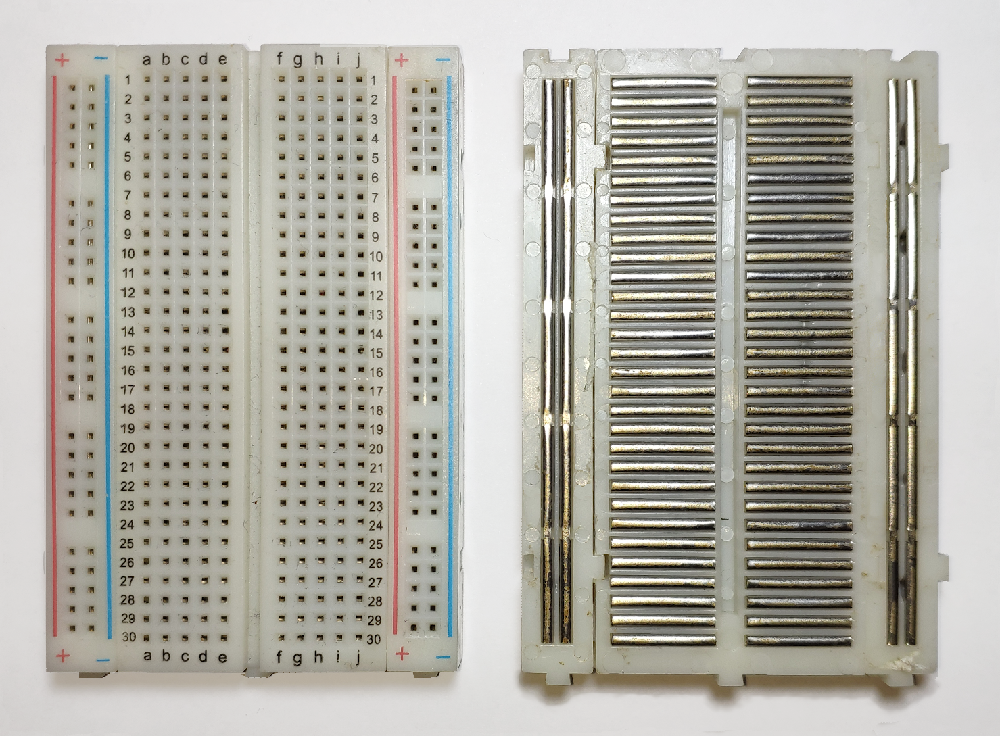

# Rust Dortmund Embedded Workshop

This workshop contains a series of exercises about starting to write embedded Rust with [`embassy`](https://embassy.dev/) targeting the the Raspberry Pi Pico 2.
Each subfolder in this repository contains one exercise.
Exercises are numbered and build upon another both in terms of code and in difficulty, so doing them in order will be easiest.
If you're new to embedded Rust or want to brush up your knowledge, there is a recording of a Rust Dortmund meetup talk giving a broad introduction to the topic that you can find [here](https://www.youtube.com/watch?v=BXjcAf0Z95Q).

There are hints for most exercises inside the README instructions for each subfolder to help you along the way.
Make sure to browse the rendered instructions and not the raw markdown files if you don't want to be spoiled.

Except for the first exercise, which doesn't yet involve any coding, the source code for each crate under `src` is intended as a starting point for the respective exercise.
Often times, this starting point will match a working solution of the previous exercise, in which case you are free to choose between using the example solution or continuing with a copy of your own previous solution.

Each exercise contains an example solution under its `example` folder that you can look at if you get stuck.
Since there are multiple ways to achieve the exercises' tasks, these solutions may not always match how your code is structured, but you can always compare against a previous example solution to see what has changed.
Note that the example solutions are separate crates and can't be run as a `cargo run --example`, but you can switch to the `example` folder and run `cargo run --release` to try them out.

## Prerequisites

- Bring your own laptop.
- You will connect to the hardware over two USB-A cables. If your laptop doesn't have 2 USB-A ports, you might need to bring additional adapters.
  - One of the USBs is only for providing power to the microcontroller. You may substitute power from your laptop by bringing a phone charger with a USB-A socket.
  - The other cable is used to program the microcontroller and definitely needs to go into your laptop. If your laptop doesn't have USB-A ports at all, please bring a matching adapter (e.g., to USB-C if that's what your laptop has).
- Clone this repo 
- Follow as much of the setup instructions under [`00-setup`](00-setup/README.md) as you want that don't yet require course hardware to prepare.

If you're going through the material yourself without a workshop or want to run the workshop with your own group

### Procuring the Hardware

You'll need to get the hardware yourself if it's not provided to you, so here's all we have on the parts we've been using:

| Part | # per Participant | Notes | How / where to buy |
| ---- | ----------------- | ----- | ------------------ |
| Raspberry Pi Pico 2W | 1 | Ideally, get pre-soldered ones ("with hats" / "with headers") | We used Mouser (358-SC1634), but they recently introduced a 10-device per customer limit. Product number RPI-PICO2-WH on berrybase. |
| Raspberry Pi Debug Probe | 1 | Comes with a USB-A data cable. Make sure to flash firmware version 2 for the debug probe if it still comes with version 1. See Raspberry's [firmware update instructions](https://www.raspberrypi.com/documentation/microcontrollers/debug-probe.html#updating-the-firmware-on-the-debug-probe). | We used Mouser (358-SC0889), berrybase is RPIP-DEBUGP. |
| APDS-9960 light and gesture sensor | 1 | We haven't found a pre-soldered version of the sensor so far, so you'll probably have to solder it yourself. The cheaper breakout boards are fine, but usually have some dropout rate, so order a couple more spares than you think you'll need. | Availability for this component varies a lot, since it's often based on when a run of the chips is produced and they have spare capacity. We've had the best luck checking Amazon for sets of 2 sensors and then ordering multiple of those. Mouser also lists it (392-333002), but only has very limited quantities. |
| Breadboard | 1 | If you want to have room, use a board with at least 45 or 60 rows. 30 can work, but is very crowded. | Amazon often has packs of 4-6 boards of which you can get multiple, e.g. we've previously used [these ones from AZDelivery](https://www.amazon.de/dp/B07VCG6Q68/?coliid=IC3QC3Z0EPBXG&colid=2W7OEX9GHTRHF&psc=1). Berrybase also has individual ones if you're looking just for yourself. |
| 50O Resistors	| 3 | Through-hole resistors that can be manually placed on the breadboard. | Any resistor with 50 Ohms is fine, we've mostly used Mouser again here (e.g., 603-MFR-25FTE52-50R). |
| RGB LEDs | 1 | 3-color LED. Must be common cathode (shared ground, distinct high voltage input per color - refer to the wiring instructions for a diagram). Otherwise, the ordering of the colors can be adjusted through the wiring or in the code. Try to find an LED with a forward voltage of at most 3.3V, which is the Pico's bus voltage. 5V LEDs won't work as well and be very dimmed with the Pico 2! For reference, the linked LEDs have a forward voltage of 2V-2.2V for the red channel and 3V-3.2V for the other channels (3.4V is also fine, you'll not quite be getting max brightness but the LED should work). If you do get other LEDs, note that you might need to adjust the resistors' resistance accordingly. | You can find packs of 100 LEDs on Amazon for good prices, e.g. we've previously used [these ones](https://www.amazon.de/dp/B0DS57SFD7/?coliid=I3324A8JZOMX1D&colid=2W7OEX9GHTRHF) (you can get either the clear or the frosted ones). |
| Micro-USB Cable | 1 | USB-A to Micro-USB, for powering the Pico 2 | Wherever |
| Jumper-Wires | 10 | If you get a big enough breadboard, you'll pretty much only need male to male wires. For a 30-row breadboard, it might make sense to get a couple of male to female ones to connect the sensor without placing it on the board. Around 15-20cm is a good length, 10cm can work but becomes tight, 30cm is excessive. Male to female wires can help act as extenders if needed (will increase wobbling / may worsen contact). | Pretty much wherever, there are many packs of these. On Amazon, we've previously used [this set](https://www.amazon.de/dp/B0D91D47RD/?coliid=I2WQZACAMPGKMX&colid=2W7OEX9GHTRHF&psc=1). Berrybase has them as DUPK-40-MM-20. |
| Anti-Static ESD bags | 1 | Optional, for packaging sets for individual participants. | Wherever, but try to find a bulk offer as prices drop drastically with number of bags ordered. We've previously used [these](https://www.amazon.de/dp/B0BS8K9TZ2?ref=ppx_yo2ov_dt_b_fed_asin_title&th=1) on Amazon (size 18 x 26, so the breadboard fits). |

## Troubleshooting

We've put together some of the more common places where people got stuck and what to do if that happens to you at [TROUBLESHOOTING.md](TROUBLESHOOTING.md).
Hopefully, you won't need to, but if you ever feel like something is just not working or if you're facing a problem and all instructors are currently busy, you might want to go and have a look if you can find a solution for your problem in there.

## Embassy

You will be using the [embassy](https://embassy.dev/) framework to write your programs during this workshop.
Embassy is a task framework for embedded Rust, which essentially means that it allows you to write multiple independent program tasks that the microcontroller will then run concurrently.
This is useful if, for example, you want to regularly update some output value (say, the color of an LED), but at the same time you want to check or wait for a new input value (e.g., a new sensor reading or an API request).

The provided code skeletons will help you along with how embassy works, but for more concrete hardware interactions (like turning on the LED) you will need to look at the documentation for the relevant types from [`embassy-rp`](https://docs.rs/embassy-rp/latest/embassy_rp/index.html).
If you prefer to get a little bit of a head start upfront, there is a recording of a Rust Dortmund meetup talk about embassy that you can find [here](https://www.youtube.com/watch?v=zsanJhEiiCE).

## Working with a Breadboard

Over the course of the workshop, you will wire up different components to the Pico 2 to be able to control them from your code.
To do so, you'll work on a so-called _breadboard_, an electrical board with multiple rows that has a grid of holes that you can insert pins into to connect different pieces of hardware without needing to solder anything together.

The breadboard internally connects some of the inserted pins electrically to reduce the amount of wires required to assemble a circuit:
a connection is made between all pins connected to the same `+` or `-` column (within the column, not from `+` to `-`).
Additionally, all pins within the same half of each numbered row are connected, but the left and right halves of each row are separate:

Breadboard Internals.
By <a href="https://commons.wikimedia.org/w/index.php?title=User:Guhuru" class="new" title="User:Guhuru (page does not exist)">Guhuru</a> - Own work, <a href="http://creativecommons.org/publicdomain/zero/1.0/deed.en" title="Creative Commons Zero, Public Domain Dedication">CC0</a>, <a href="https://commons.wikimedia.org/w/index.php?curid=97240411">Link</a>

## License and Attributions

Copyright for the materials in this repository is held by Björn Barwinski and Domenic Quirl, 2025. 
Exercise and example code is provided under either of the [MIT license](./LICENSE-MIT) OR the [Apache License, Version 2.0](./LICENSE-APACHE) at your option.
The workshop instructions, presentation slides, README text and all of the graphics created for the presentations are licensed under the Creative Commons Attribution-NonCommercial 4.0 International license ([CC BY-NC 4.0](https://creativecommons.org/licenses/by-nc/4.0/)) unless otherwise noted. 
See [LICENSE-CC-BY-NC](./LICENSE-CC-BY-NC) for the full license.

Unless you explicitly state otherwise, any contribution intentionally submitted for inclusion in this codebase by you, as defined in the Apache-2.0 license, shall be licensed as above, without any additional terms or conditions.

The presentation framework RevealJS used to create the introductory slides is licensed under an MIT license (see [LICENSE-RevealJS](000-intro/LICENSE-RevealJS)).

The logo from awesome embedded Rust is licensed under the [CC0 1.0 Universal License](https://creativecommons.org/publicdomain/zero/1.0/legalcode).

The wiring diagrams and associated `.fzz` files were created with [Fritzing](https://fritzing.org/) including their [parts library](https://github.com/fritzing/fritzing-parts/), which is licensed under the Creative Commons Attribution-ShareAlike 3.0 Unported license ([CC BY-SA 3.0](https://creativecommons.org/licenses/by-sa/3.0/), see [LICENSE-FRITZING](./LICENSE-FRITZING)), and are made available under the Creative Commons Attribution-ShareAlike 4.0 International license ([CC BY-SA 4.0](https://creativecommons.org/licenses/by-sa/4.0/)) (see [Compatible Licenses](https://creativecommons.org/compatible-licenses/)).
Some of the parts used are from the SparkFun Fritzing parts library, which is licensed under an MIT license ([LICENSE-SPARKPLUG](./LICENSE-SPARKPLUG)).
